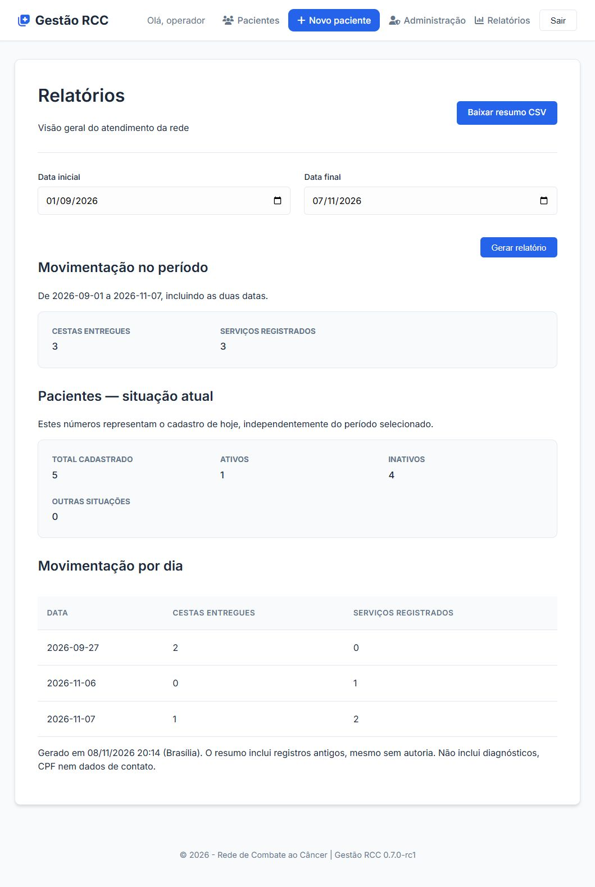

# Relatórios — 0.7.0-rc1

Validação em 08/11/2026, na aplicação local conectada ao Oracle ORDS, com dados fictícios.

- Login de administrador e acesso ao menu Relatórios pelo navegador.
- Filtro de 01/09/2026 a 07/11/2026: 3 cestas entregues e 3 serviços registrados.
- Situação atual: 5 pacientes cadastrados, 1 ativo e 4 inativos. Esse quadro independe do período.
- Respostas HTML e CSV verificadas com HTTP 200 usando a integração real, apenas para leitura.
- Suíte automatizada: 47 testes aprovados, incluindo restrição a administradores, datas inválidas, contagem sem duplicação e falhas da API.

A captura demonstra a execução local. Não comprova atualização ou validação no Render. Nenhum cadastro foi alterado na validação destes relatórios.
